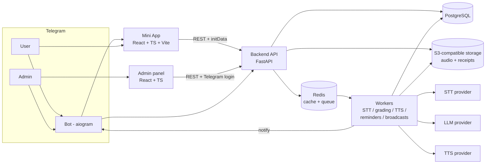
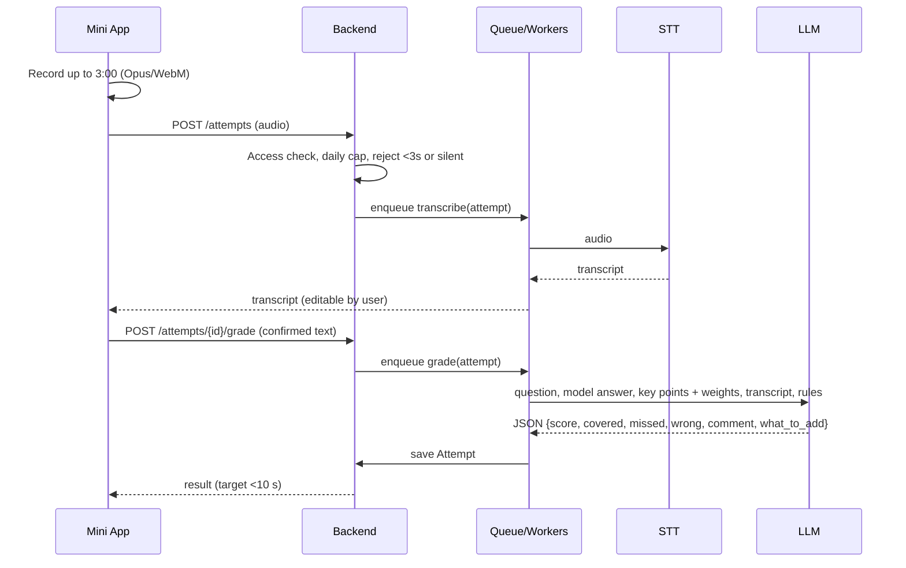
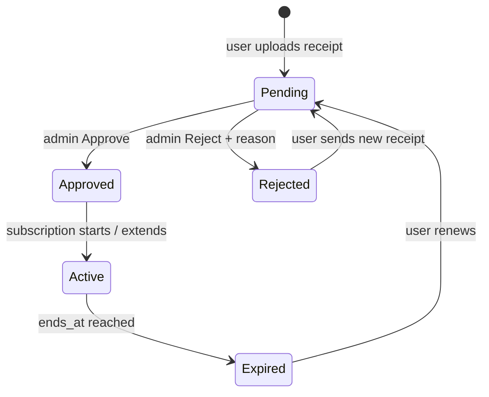
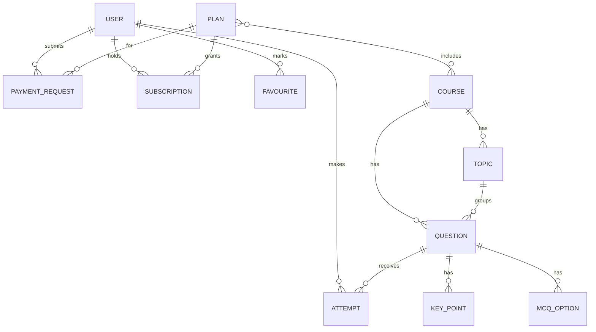

# Oral Exam Trainer Mini App — Architecture

Source: *TD: Oral Exam Trainer Mini App* (Nov 11, 2026). Working title; final name is an open question.

A Telegram Mini App where specialists practise oral qualification exams by voice. The user answers into the microphone, an AI grades the answer 0–5 against the model answer and key points, and explains what is missing. First course: nurses' oral category exam (145 questions, Uzbek). Access is paid and approved by hand by the admin.

## 1. System overview



Components share one backend and one database. STT, LLM and TTS are each behind an adapter interface and swappable by config.

| Component | Tech | Responsibility |
|---|---|---|
| Mini App | React, TypeScript, Vite, Telegram Mini Apps SDK | All learner screens; recording; Telegram light/dark theme |
| Admin panel | React, TypeScript (same codebase or separate app on same API) | Users, payments, content, audio, grading rules, broadcasts, reports, logs |
| Backend API | Python FastAPI, REST | Auth, business rules, access checks, signed file URLs |
| Workers | Python, Redis queue | STT, grading, TTS generation, reminders, expiry, broadcasts, retention cleanup |
| Bot | aiogram | `/start`, contact sharing, "Open app", payment alerts with Approve/Reject, reminders |
| Database | PostgreSQL | System of record |
| Cache / queue | Redis | Job queue, rate limits, daily grading counters |
| File storage | S3-compatible (e.g. Cloudflare R2) | Question/answer audio, user recordings, receipts; private, expiring links |
| Hosting | One VPS (4 vCPU / 8 GB), Docker Compose, daily DB backups | Launch target: 1,000 active users, 200 graded answers/hour |

## 2. Roles and access

| Role | Access |
|---|---|
| Guest | Course list, 3 free demo questions (setting), can send a subscription request |
| Pending | As Guest, plus request status |
| Subscriber | Full access to courses in the plan |
| Expired | History and stats only; cannot start new answers; can renew |
| Blocked | "Contact support" screen only |
| Admin | Everything. Owner only at launch; Moderator and Content editor roles later |

Access is derived from `User.status` plus the active `Subscription`. A single access-check function is the only gate for paid actions; the paywall is shown when it fails.

## 3. Exam engine

Every answer goes through four steps: **record → transcribe → grade → show**.



- **Grading output** is JSON: score 0–5 (step 0.5), covered/missed key points, wrong statements, 2–4 sentence comment, short "what to add". Score = weighted share of covered key points minus a penalty for medically wrong statements. The prompt and rules are editable in the admin panel.
- **Persistence**: every attempt stores the audio, transcript and grade, so the admin can review and set `manual_score`.
- **Reliability**: if STT or the LLM fails, the attempt is saved in a pending state, retried with backoff, graded automatically when the service returns, and the user is told.
- **Cost control**: daily graded-answer cap per user (setting, e.g. 60); `ai_cost` stored per attempt and aggregated per day and per user for the dashboard.
- **TTS**: question and model-answer audio is generated once and stored. Priority 1: teacher's recording uploaded by admin. Priority 2: AI voice generated in the admin panel (Uzbek, Russian). Clients cache audio after first play.

## 4. Subscriptions with manual approval



1. User picks a plan, sees card number, holder, amount and a unique payment code (e.g. `#4821`) with Copy buttons.
2. User pays externally (Click / Payme / bank), taps "I paid", uploads a receipt screenshot.
3. A `PaymentRequest` is created as `pending`; the bot messages the admin within 10 s with name, phone, plan, amount, code, receipt and Approve / Reject buttons. The same request is in the admin panel.
4. Approve creates or extends a `Subscription` immediately and notifies the user ("Access is open until …"). Reject asks for a reason (amount wrong, receipt unreadable, payment not found, other) and notifies the user.
5. A scheduled job sends reminders 3 days and 1 day before expiry, and flips status to Expired on the end date.

Rules: admin can grant/extend/shorten/cancel without payment (`source` = payment / gift / promo); every change goes to `AuditLog` with actor and reason; one subscription = one Telegram account. Click/Payme auto-payments later plug in by auto-approving the same request, with no flow change.

## 5. Data model

| Entity | Key fields |
|---|---|
| User | telegram_id, phone, full_name, ui_language, course_id, status, created_at, last_seen |
| Course | name (uz/ru/en), description, cover, is_published |
| Topic | course_id, name, order |
| Question | course_id, topic_id, number, text, model_answer, explanation, question_audio, answer_audio, is_active |
| KeyPoint | question_id, text, weight |
| McqOption | question_id, text, is_correct |
| Plan | name, course_ids, days, price_uzs, is_active |
| PaymentRequest | user_id, plan_id, amount, payment_code, receipt_image, status, reject_reason, reviewed_by, reviewed_at |
| Subscription | user_id, plan_id, starts_at, ends_at, source, status |
| Attempt | user_id, question_id, mode, audio_file, transcript, score, covered_points, missed_points, comment, ai_cost, manual_score, created_at |
| Favourite | user_id, question_id |
| Broadcast | text, image, button, segment, scheduled_at, sent_count |
| Setting | key, value |
| AuditLog | admin_id, action, object, old_value, new_value, reason, created_at |

Implied additions: a `wrong_statements` field on `Attempt`, an attempt processing state for the retry flow, and an i18n texts table for editable UI strings in three languages.



Multi-course support is data-driven: a new profession or exam is a new `Course` with its questions and plans, with no code change.

## 6. Security and non-functional requirements

- Every Mini App request is verified against the Telegram `initData` signature; there are no passwords or logins.
- The admin panel runs in a browser and signs in with the Telegram Login Widget; the backend verifies the widget signature and issues a signed 7-day session token. Only Telegram IDs on the admin list get a token.
- Receipts and recordings are never public: private bucket, short-lived signed URLs.
- Speed: app opens in under 3 s on 4G; grade result in under 10 s for a 3-minute answer.
- Languages: UI in Uzbek (Latin), Russian, English, editable in admin. Course content keeps its original language.
- Data: user can delete their account from Profile; recordings older than 90 days are auto-deleted (setting).
- Backups: daily PostgreSQL backups.

## 7. Admin panel modules

Dashboard · Payment requests · Users · Subscriptions and plans · Courses · Questions (Excel/Word import, Excel export) · Audio · Grading (prompt, rules, test, review, manual score, low-confidence list) · Broadcasts · Content and texts · Settings · Reports · Logs. Quick actions (approve/reject, reply to users) also work from the bot.

## 8. Proposed repository layout

```
nurses/
├── backend/            # FastAPI app: api/, models/, services/, workers/, providers/ (stt, llm, tts)
├── bot/                # aiogram bot, calls backend
├── miniapp/            # React + TS + Vite learner app
├── admin/              # React + TS admin panel
├── infra/              # docker-compose.yml, reverse proxy, backup scripts
├── docs/               # spec, ADRs
└── ARCHITECTURE.md
```

## 9. Scope and build order

**MVP:** screens 1–7 (start, onboarding, home, oral exam start, question, answer, result), 11 (My results), 13 (Profile and subscription), 14 (Paywall); voice grading; manual subscriptions; admin modules Dashboard, Payment requests, Users, Plans, Courses, Questions, Audio, Settings, Logs; one course.

**After MVP:** Mock exam, Learn mode, Test mode, Statistics charts, Favourites, Broadcasts, Reports, Grade review, promo codes, Click/Payme auto-payments, more admin roles.

| Stage | Result | Estimate |
|---|---|---|
| 1. Design | Clickable mock-ups of MVP screens and admin pages | 1 week |
| 2. STT/TTS test | 20 real recordings on 2–3 providers, provider chosen | 3 days |
| 3. Backend + bot | Auth, users, questions, subscriptions, payment requests, approval from bot | 2 weeks |
| 4. Mini App | All MVP screens, recording, grading, results | 2 weeks |
| 5. Admin panel | MVP modules, Excel import, AI voice generation | 1.5 weeks |
| 6. Content | 145 questions, key points, audio loaded and checked | parallel to 3–5 |
| 7. Beta | 10–20 real nurses, fix bugs, tune grading | 1 week |
| 8. Launch | Public bot, first paid subscribers | — |

**Acceptance criteria:** /start to first graded answer in under 2 minutes; AI score within 1 point of the teacher's on at least 85% of 50 test answers; payment request reaches admin within 10 s and approval opens access within 10 s; expiry and reminders automatic; admin can add a question with audio without a developer.

## 10. Open questions

- Product name, logo, bot username.
- Who writes and checks key points for the 145 questions (nurse-teacher partner?).
- Price per plan.
- Play the model answer before answering by default, or only on request?
- Uzbek Cyrillic UI as well, or Latin only?
- STT provider choice (decided by the stage 2 test).
